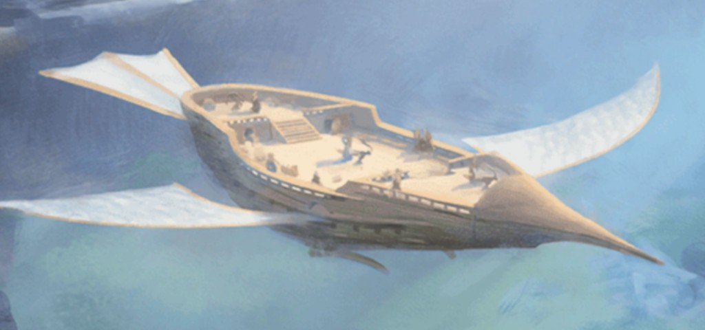
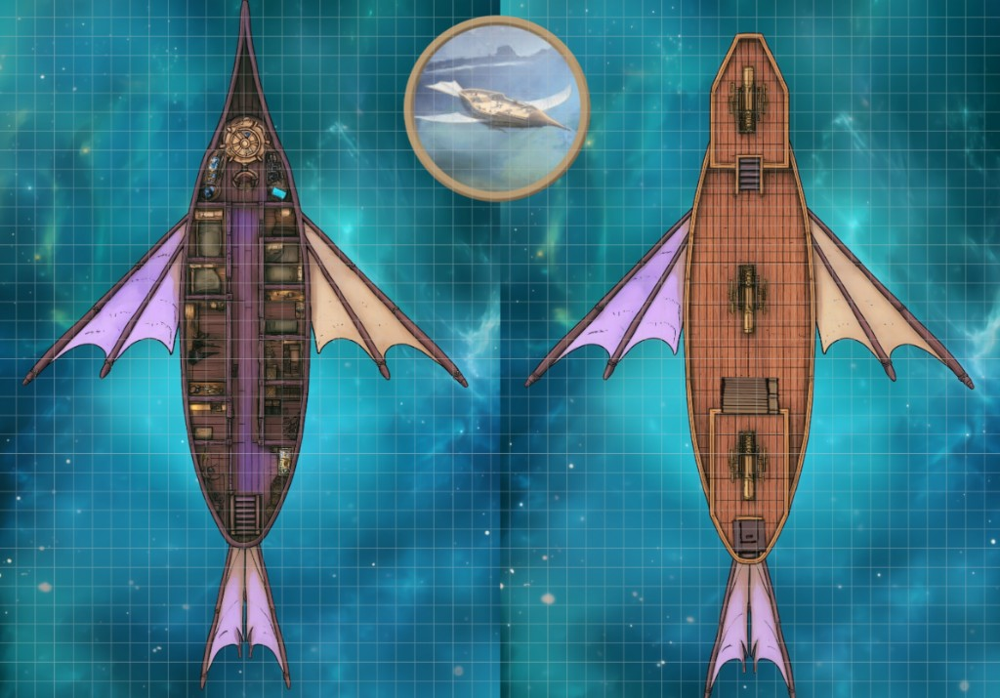

# Session 6 plan — crew, launch, first stop

Follow top to bottom. **Blockquotes are read at the table.** Everything else in a beat is notes. Crew survey already sent to Brad.

**Pickup:** townhome (Lucy and Pip slept; Korran did not) → Shrike dock → **Brownish Greenspot** walks up (Session 5 cliffhanger, Matt live) → crew montage → Lucy and Pip aboard → charts → launch → **halfway wreck** (not the Split Current). A small pirate fight on the open deck.

Do not NPC Brownish. Do not voice him. Stub: [`player-characters/brownish-greenspot.md`](../player-characters/brownish-greenspot.md). Session 5 table: Skipper. Name: **Brownish Greenspot**. Sheet still waiting.

---

## Crew (mid-session)

Marfa's **crew of 6** is Dottie, Wrench, Lumen, and the three penguins (three-for-two). **Brownish Greenspot** is a seventh. Lucy and Pip have no ship job unless they take one. **Jetson is not aboard** (grounded).

| Who | Race | Role | Notes |
| --- | --- | --- | --- |
| [Korran](../player-characters/korran-cloudjumper.md) | Hadozee | Captain / helm | Brad |
| [Brownish Greenspot](../player-characters/brownish-greenspot.md) | Bullywug | Navigator | Matt. Chart table, not the helm. **Do not voice.** |
| [Dottie](../npcs/dottie.md) | Giff | Bosun | Marfa's first. Met Session 5. |
| [Wrench](../npcs/rocco-wrench.md) | Giff | Engineer | Insight 18. Met Session 5. |
| [Lumen](../npcs/lumen.md) | Autognome | Purser | Does not cook. Insight **5**. Montage. |
| [Nedd, Nodd, and Nudd](../npcs/nedd-nodd-nudd.md) | Dohwar | Stewards | **Cook** and hold. Silent. Insight **5**. Montage. |
| [Lucy](../player-characters/luckyluciano-ruth.md) | Giff | — | Nicole |
| [Pip](../player-characters/pip-oozewald.md) | Plasmoid | — | Drew |

The triplets cook. Lumen, Dottie, and Wrench do not.

## Ship pictures (reference)

Not for the table unless Nolan shares them. [`ships/korran-shrike-exterior.png`](../ships/korran-shrike-exterior.png), [`ships/korran-shrike-map.jpg`](../ships/korran-shrike-map.jpg). Notes: [`ships/korrans-stolen-ship.md`](../ships/korrans-stolen-ship.md#pictures-reference).

Helm in the needle. Bunks port. Galley amidships. Hold and stairs aft. Open deck above with two ballistae.

---

## 1. Townhome

Lucy and Pip. They long-rested. Keep it short. Then cut.

> You actually slept. The townhome is quiet. Somewhere a kettle ticks. Bral's dock-noise is a few streets away, thinner than it was last night.
>
> Cut.

---

## 2. The Shrike (dock)

Show the exterior if you want. Korran has not slept. Dottie and Wrench are already aboard from Session 5.

> The Shrike sits in its berth like a knife in a drawer: needle bow, white wing-sails folded, open deck above, the hatch in the floor already yawning. Lantern light from below. Dottie is on the clipboard. Something metallic clinks in the hole — Wrench.
>
> Korran has been at that hatch long enough that the same five questions are still in his mouth. Ruth family. Loyalties. Job. Combat. Crews, legal or not. He is groggy. He has not slept.

---

## 3. Brownish Greenspot walks up

> Someone is coming up the dock.

**Matt from here.** He names himself. Do not voice him. Do not answer the five questions for him. If Brad wants a live Insight after they have talked, that is a table roll. A low result still does not dump him.

**Why he stays:** Bral has sailing masters. Ones willing to work with the Ruths are rare. He is the only one of those **available this week**. That is why he specifically is non-negotiable. Chart table, not the helm. The map does not leave the ship. Korran can say he does not trust him. That is the join.

He took Ruth work, so he is not on the straight and narrow as a rule. **Matt still decides what that looks like.** Do not pre-bake his crimes.

If Korran tries to fire him, Dottie (only then):

> "Sailing masters who'll work with the Ruths don't grow on trees. He's the only one I could get this week. You dump him, we don't start over."

---

## 4. Crew montage (after Brownish)

Read the whole block. Do not play six voices. Do not voice the penguins.

> The rest of Marfa's people show up while the night is still ugly. You do not get six full interviews. It goes like this.
>
> A small brass person comes up to Dottie's belt. Ledger already open. Pen already moving.
>
> "Lumen. Purser. Marfa hired me. I keep the books so the trip stays lucrative and does not bankrupt the family. Wages, stores, whatever you bring back. I do not steer. I do not cook. I do not fight."
>
> Painted smile. The pen never stops. Korran cannot get a read. He is too tired.
>
> Then three identical penguins in oilskins over tuxedos, in the galley doorway. Same height. Same lean. They do not speak. They nod. They shake their heads. Black beady eyes, glazed over almost all the time.
>
> Dottie, without looking up from the clipboard: "Galley and hold. They cook, they stow. Nedd, Nodd, and Nudd. Three for the price of two. They wouldn't split. Pie-credit and a cut of whatever we happen to acquire. Don't wait for them to say hello."
>
> Ruths: three slow shakes. Combat: three shakes. They look at each other and nod once. Korran cannot tell them apart and cannot tell if they heard him.
>
> That is the crew. The dock is getting light.

**Locked rolls** (exhaustion 1, disadvantage; do not name it unless asked):

| Who | Insight | DC | Result |
| --- | --- | --- | --- |
| Lumen | **5** | 13 | Fail. Suspects. Cannot pin it. |
| Triplets | **5** | 13 | Fail. One roll for the set. |

Do not re-roll Wrench (18). Optional Dottie Insight only if Brad re-grills her live.

**If someone asks live**

- **Dottie:** thirty years family decks; cargo that never hits a registry; watches paid in hush; Marfa's; bosun; writes home. Thinks he is a kid.
- **Wrench:** cousin's cousin's dad; engine; ballistae first; military dock work; talks to himself; limp.
- **Lumen:** Marfa hired him; books; no combat. Do **not** say the ledger is the spy (that was the 13). Dumping him dumps Marfa's money.
- **Triplets:** cook and stow. Silent. Pie-credit and a cut of whatever the ship happens to acquire — spoils, not payroll. Insight 5 was whether he could read them.

**Ruth ships, locked (Nolan to Brad):** they kinda all have a criminal background. Anyone willing to work on a Ruth ship is not on the straight and narrow. Charisma and greed are the right tools — buy, scare, cut them in. Available, not automatic.

- **Dottie:** thirty years family decks. Cargo that never hits a registry. Watches that get paid in hush.
- **Penguins:** not a steward's wage. Pie-credit and a cut of whatever this ship happens to acquire. Spoils, not payroll.
- **Wrench and Lumen:** same rule. Specific rap sheets stay in their files. Do not auto-succeed a sway.
- **Brownish:** the general rule applies (he took Ruth work). Matt still decides what that looks like. Do not pre-bake his crimes.

---

## 5. Lucy and Pip at the hatch

> The hatch smells like oil and old pizza. Below: a needle of a helm, bunks along one wall, a galley already occupied by three silent penguins, a hold stuffed with someone else's idea of stores. Above: open deck, two ballistae, wings like sails. Dottie does not look impressed that you slept.

They meet this crew for the first time. Jetson is grounded if they ask.

---

## 6. Chart table

Helm is in the needle. Brownish lives here. Varrow's Split Current chart is already Korran's. The treasure map is Korran's to show or not. He failed the overlap in the office; Brownish can argue the doodles. Heading tonight is still the Split Current either way.

> The wheel is in the point of the ship. Charts want a table, not a lap. The hull still ticks. Somewhere below, Wrench talks to no one about a bolt.

---

## 7. Launch

No "PUNCH IT." Jetson isn't here. Korran is exhausted on the helm unless he hands it off.

> Wrench shouts something from below that is probably permission. Dottie does not wait for it. Lines come in. The Shrike slips its berth the way a knife leaves a drawer.
>
> The Rock of Bral falls away: towers on towers, laundry, a hundred colours that do not belong to any one world. Dock-noise thins. The ticking of the hull becomes the only close sound, and then even that is eaten by the dark.
>
> Ahead, the silver haze of the Astral Sea. Somewhere past it, warm gold light. In the galley, three penguins cook without a word. Lumen writes *under way* in a ledger.

---

## 8. First hour out

Use if you need a breath before the stop. Open deck = the flight picture. Lower deck = the map.

> Open deck, empty of Bral. Two ballistae with covers still on. The wings catch no wind and still hold. Below, the aisle is narrow enough that you choose who you bump. The triplets' eyes stay glazed. The painted smile keeps writing.

Sending Stone still has nobody on the other end if they try it.

---

## 9. Halfway wreck (first stop)

Draft. **Not the Split Current.** The fork stays ahead. Ships auto-exit hyperspeed at a planet or entity of note ([house rules](../house-rules.md)). This wreck is that.

Taken from the unused travel list: [Trapped Traveler](../random-encounters.md#1-trapped-traveler) plus a small [Classic Space Pirates](../random-encounters.md#8-classic-space-pirates) boarding. **Not** a neogi nightspider.

A salvage hulk lashed to a rock, halfway to the gold. Air, rumor, a topping-off stop Brownish would know. Someone is waving from a cracked porthole — a haggard astral elf in a sealed cabin, air running out. They are not Varrow. Then a small pirate skiff uses the rescue as cover and comes over the rail onto the **open deck** (two ballistae, the flight picture). Short fight: 2–4 boarders, one ugly round, not a war. Whether the elf is bait or a real victim can wait until they take a prisoner.

> Hyperspeed coughs. The silver goes still. Ahead of the heading, not on it: a rock with a wreck lashed on like a tick. No gold current yet. No islands. A lantern in a cracked porthole, and someone waving.
>
> Dottie, flat: "Halfway. Top off or don't. The fork's still ahead."

If they go aboard the wreck first:

> No gravity in the sealed cabin. No air. An astral elf floats in the last of an Air Bubble, out of slots, about to suffocate.

When the skiff hits (open deck):

> Lines over the rail. Not a nightspider. A small ugly boat and too many people with knives. They waited for you to look at the wreck.

**Do not** put Varrow here. **Do not** reach the groves. Gold light still ahead after they leave.

Parked: ex-*Star-Reaver* crew, neogi, Joisey Shore, naming the ship, the Current itself.

---

## Sit on it (not table)

- **Ship name:** *Star Cleaver*. Imposter syndrome. Brad and Korran sit on it. Do not announce.
- **Later hook:** an ex-*Star-Reaver* crewmate on the voyage. Not this batch. Brad said "Gloambeard"; wiki stays **Gloamcast**.

---

## End of session: level up

The party is still **level 7**. When you wrap, **level them up.** Brownish included, if he is on the sheet by then.
