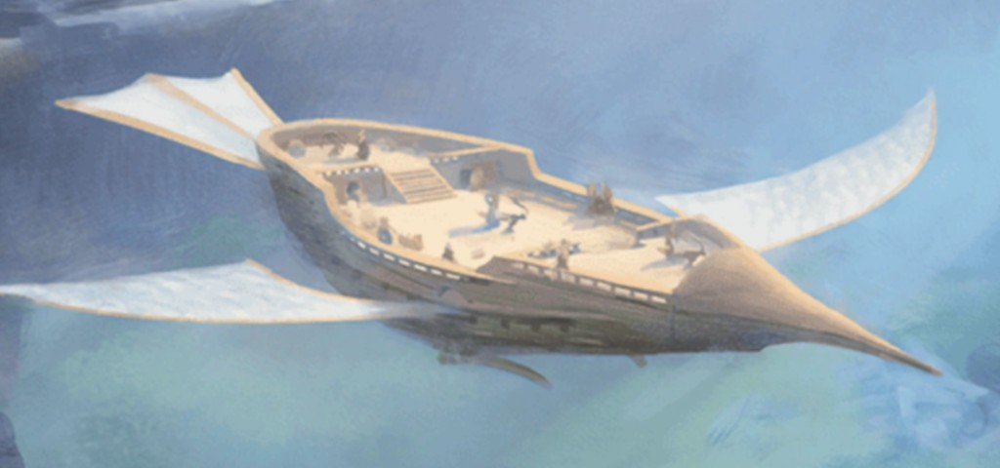
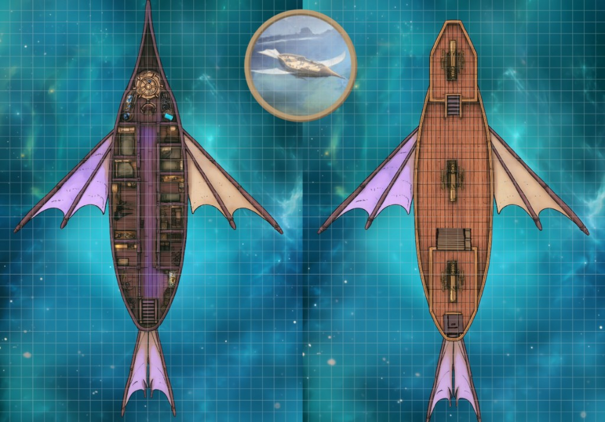

# Korran's Stolen Ship

**Appears in:** Season 1, Season 2

A smaller ship that [Korran](../player-characters/korran-cloudjumper.md) hijacked out of the [plasmoid mothership](plasmoid-mothership.md)'s loading bay at the end of Session 7.

**Class: a Shrike ship** (Nolan's ruling, after Season 1). Name chosen, unspoken: ***Star Cleaver*** (imposter syndrome). Brad and Korran sit on it. Do not announce at the table.

## Pictures (reference)

Nolan's table art. Not shown unless he shares them.

**From the map, if anyone asks where something is:** helm and wheel in the needle. Bunks along the port side. Center aisle. Galley amidships (stove, barrels — the triplets). Hold and stairs aft. Open deck above: hatches, crates, two ballistae. Wings off the beam.

## Open

- Name is chosen but not public. Crew capacity, weapons: still to be decided.
- Whether the plasmoids noticed the theft, and whether they want it back: `[unconfirmed]`.
- Whether it becomes the party's new ship now that the Damselfly is gone: `[unconfirmed]`.
- **Possible direction (Nolan):** re-register it so the plasmoids can't follow it so easily. See the [Session 1 brainstorm](../season2/session1-brainstorm.md#why-the-party-is-at-the-iron-annex). **Session 5:** Marfa says registration **has gone through**. Paperwork at the helm looked legit. Re-registering **wipes the scry**. Name is *Star Cleaver*; do not say it yet.

## Season 1

### How he got it

Korran spacewalked from the dispelled [Damselfly](the-damselfly.md) to the mothership in the Fish Suit (stealth 29) and got inside through a **crack in its hull**. He was planning to sabotage the mothership itself or go after [Alkgleb](../npcs/alkgleb.md) and [Kirrak](../npcs/kirrak-freelin.md). Instead he found this ship in the loading bay, **took control of its spelljamming helm**, and flew it out.

He flew it to the [Rock of Bral](../locations/rock-of-bral.md) alongside Marfa's [*Slice Runner*](ruth-family-ships.md#the-slice-runner), which carried the rest of the party.

## Season 2

### Session 1

Docked beside the *Slice Runner* at the Bral shipyard. [Lawrence](../npcs/lawrence.md), the dock officer, waived the costs because of Marfa, but said the ship **still has to be registered at the DAV** when it opens a couple of hours later. Per Nolan's plan, re-registering wipes the scry-locating trace on the ship, and probably on whoever took its helm, and makes it officially Korran's. As of the end of Session 4, it's **not yet registered**.

### Session 5

Marfa told the party registration **went through**. Korran found the paperwork at the helm; it looked legit. Scry trace wiped.

He skipped a long rest to vet the crew. [Dottie](../npcs/dottie.md) and [Wrench](../npcs/rocco-wrench.md) arrived. [Lumen](../npcs/lumen.md) and [Nedd, Nodd, and Nudd](../npcs/nedd-nodd-nudd.md) have not appeared yet. [Brownish Greenspot](../player-characters/brownish-greenspot.md) (Matt; Session 5 table called him Skipper) is approaching as navigator — leave him for next session. Marfa's lock: sailing masters willing to work with the Ruths are rare; he is the only one of those available this week. Ship name *Star Cleaver*; sit on it. They did **not** launch. Jobs are in the [Session 5 plan](../season2/session5-plan.md#who-does-what-on-this-ship) and the [Session 6 crew table](../season2/session6-plan.md#crew-mid-session).
